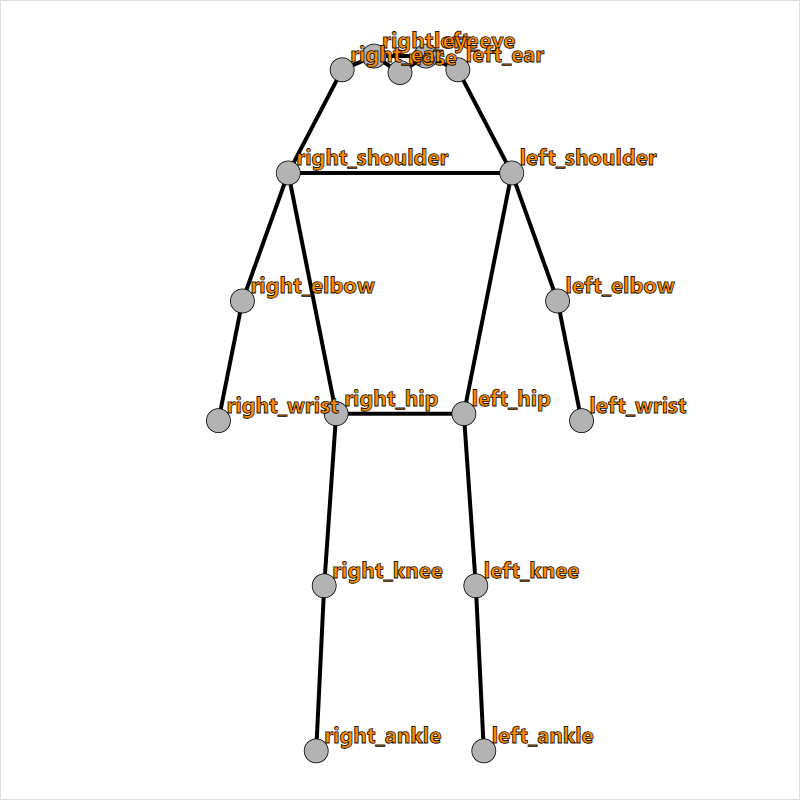
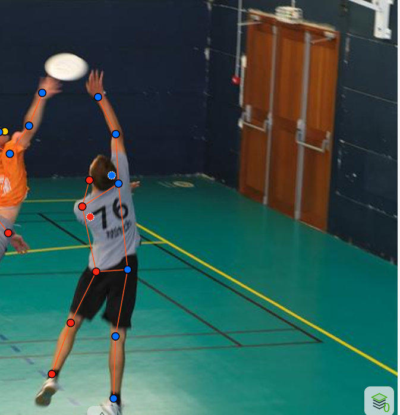
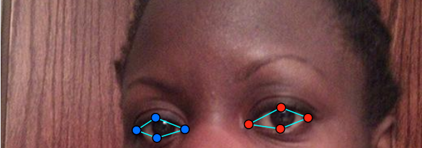
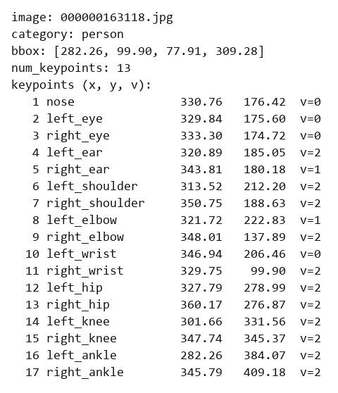

# Báo cáo cá nhân — Nguyễn Đức Hạnh — 2A202603344

Dữ liệu: 12 ảnh người COCO val2017 (Lin et al., 2014) và 8 ảnh chân dung Wikimedia Commons, chỉ dùng trong lớp.

## 0. Thông tin học viên

- Họ tên: Nguyễn Đức Hạnh
- MSSV: 2A202603344
- Email: duchanhdev@gmail.com
- Link repository: https://github.com/duchanhdev/K5-L2-Day04-NguyenDucHanh-2A202603344-KeypointPose
- Phiên bản CVAT (Help → About): 2.82.0
- Máy: hệ điều hành Windows 11 · RAM 16 GB · chạy CVAT chế độ đầy đủ
- Bộ ảnh (`src/exports/assignment.json` do `lab.py setup` tạo): có
- Giờ bắt đầu: 16h45
- Giờ kết thúc: 19h30

## 1. Kiểm tra label (CP0)

| Label | Kiểu | Số điểm | Tên điểm đúng bảng của lab? | Đúng thứ tự? | Số cạnh |
|---|---|---:|---|---|---:|
| `person` | Skeleton | 17 | Có | Có | 19 |
| `face` | Skeleton | 13 | Có | Có | 13 |

Mẫu `person` dựng theo người quay mặt về camera (các điểm `left_*` nằm bên phải khung mẫu)? Có

Cách đổi cờ `occluded` / `outside` cho **một điểm** trên phiên bản CVAT này (một câu):

Rê chuột vào đúng điểm đó, bấm `Q` để bật `occluded` hoặc `O` để bật `outside`. Bấm lại lần nữa thì tắt. Chuột phải vào điểm cũng có hai mục này. Chỉ điểm đang rê chuột bị đổi.

## 2. Số lượng đã gán và thời gian (CP1, CP2)

| Nhóm ảnh | Số ảnh | Số skeleton đã gán | Số người dưới 60 px (không gán) | Số poster / gương / màn hình bỏ qua | Thời gian (phút) |
|---|---:|---:|---:|---:|---:|
| `easy` | 5 | 5 | 0 | 0 | 20 |
| `occluded` | 3 | 6 | 0 | 0 | 25 |
| `back` | 2 | 4 | 0 | 0 | 20 |
| `small` | 1 | 2 | 1 | 1 (tivi) | 10 |
| `crowd` | 1 | 3 | 3 | 0 | 15 |
| `faces` | 8 | 8 | — | 0 | 25 |

- Số ảnh người đã xong ở mốc phút 105: 10 / 12
- Thời gian thực tế (phút): CP1 90 · CP2 25 · CP3 15
- Ảnh tốn thời gian nhất là `000000393909`. Hai người nằm, chân chồng lên nhau, một người có chó trên đùi, nên mình phải lần từng chân xem của ai.

Ảnh `small` (`000000150192`) có thêm một người ngồi phía sau, thấp hơn 60 px, mình không gán. Tivi trên tường cũng bỏ qua. Ảnh `crowd` (`000000326480`) có khoảng 3 người ở xa, trước nhà và cạnh xe, dưới 60 px, không gán.

## 3. Bảng ca khó (CP1, CP2)

| Ảnh | Người / mặt | Điểm | Cờ đã chọn | Phân vân giữa | Lý do chọn |
|---|---|---|---:|---|---|
| `000000324953` | đầu bếp quay lưng, bên phải | `nose`, `left_eye`, `right_eye` | 1 | `v = 1` và `v = 0` | Không thấy mặt. Mình vẫn đặt được vị trí đầu theo gáy và hai vai nên để `occluded`. |
| `000000022857` | đầu bếp phía trước | `left_ankle`, `right_ankle` | 0 | `v = 0` và `v = 1` | Hai chân bị cắt sát mép dưới ảnh. Mình để `outside`, không kéo lên mép. |
| `000000150192` | người ngồi trước | gối và cổ chân hai bên | 0 | `v = 0` và `v = 1` | Chân khuất sau bàn, không chắc gối nằm đâu. Hông vẫn thấy theo thân người nên để `v = 1`. |
| `000000163118` | áo xám số 16, quay lưng | `nose`, `left_eye`, `right_eye` | 0 | `v = 0` và `v = 1` | Chỉ thấy gáy. Tai phải còn đoán được vành nên `right_ear` là `v = 1`, còn mũi và mắt để `outside`. |
| `000000163118` | áo xám số 16 | `left_wrist` | 0 | `v = 0` và `v = 1` | Tay trái khuất sau thân. Tay phải giơ lên, thấy rõ, nên `right_wrist` là `v = 2`. |
| `000000393909` | người bên phải, có kính | `left_ankle`, `right_ankle` | 1 | `v = 1` và `v = 0` | Hai cổ chân nằm sát nhau, chồng với chân người kia. Còn thấy tất nên mình để `occluded`. |
| `face_294580` | kính râm | 8 điểm mắt | 1 | `v = 1` và `v = 0` | Tròng tối, không thấy con ngươi, nhưng gọng kính đủ để đặt khóe và mí. |
| `face_560282` | tóc và vành mũ | 4 điểm mỗi mắt | 2 | `v = 2` và `v = 1` | Tóc chạm trán nhưng mí và khóe vẫn thấy, nên để bình thường. |

## 4. Bảng tự review (CP3)

Mình xem từ ảnh cuối về ảnh đầu. 5 ảnh người (có `crowd` và 2 ảnh `back`) và 3 ảnh mặt.

| Ảnh | Người / mặt | Điểm | Mã lỗi | Ghi chú | Đã sửa? |
|---|---|---|---|---|---|
| `000000326480` | 3 người phía trước | cả skeleton | `ok` | Cả ba người nhìn về phía camera, `left_*` nằm bên phải ảnh. Người ở xa không gán. | Có |
| `000000163118` | áo xám số 16 | cả người | `ok` | Quay lưng, `left_shoulder` bên trái ảnh. Mũi và hai mắt `v = 0`. | Có |
| `000000163118` | áo cam | cả người | `lr_swap` | Thấy mặt và mặt trước áo, nhưng vai trái lại nằm bên trái ảnh. | Không |
| `000000022857` | người nền bên trái | mặt, tay trái | `ok` | Quay lưng, `left_*` bên trái ảnh. Mặt và tay trái bị cắt mép, để `outside`. | Có |
| `000000022857` | đầu bếp nhìn sang phải ảnh | vai và tay đưa ra bếp | `ok` | Bên gần camera là bên phải của anh ấy. Tay đưa tới bếp là tay phải. Hai chân cắt mép dưới. | Có |
| `000000324953` | đầu bếp quay lưng | `nose`, `left_eye`, `right_eye` | `vis_flag` | Thân đúng hướng quay lưng. Mặt không thấy nhưng ba điểm mặt mình để `v = 1`. | Không |
| `000000150192` | người ngồi | gối, cổ chân | `ok` | Chân sau bàn là `v = 0`. Người nhìn camera, `left_*` bên phải ảnh. Tivi không gán. | Có |
| `face_415073` | mặt nghiêng, nhìn sang trái ảnh | hai mắt | `ok` | Mắt gần camera là mắt trái, nằm bên phải ảnh. Mắt xa sát sống mũi là mắt phải. | Có |
| `face_79591` | mặt nghiêng, nhìn sang phải ảnh | hai mắt | `ok` | Mắt to bên trái ảnh là mắt phải, mắt gần camera. Mắt xa là mắt trái. | Có |
| `face_294580` | kính râm | 8 điểm mắt | `ok` | Mặt thẳng, mắt trái bên phải ảnh. Tám điểm mắt đều `v = 1`. | Có |

Tổng hợp số lỗi theo mã:

| `lr_swap` | `vis_flag` | `position` | `missing` | `extra` | `ok` |
|---:|---:|---:|---:|---:|---:|
| 1 | 1 | 0 | 0 | 0 | 8 |

Điểm còn phân vân giữa `v = 1` và `v = 0`:

Ở `000000324953`, đầu bếp quay lưng, mình phân vân `nose` và hai mắt. Để `v = 1` vì gáy với hai vai cho một chỗ đặt đầu khá chắc. Để `v = 0` vì không thấy mũi mắt. Mình chọn `v = 1`. Sau khi xem lại thì thấy đáng lẽ để `v = 0`, vì đoán không chắc mà vẫn cho trọng số thì model học theo điểm đó.

## 5. Kiểm file xuất và kết quả tự kiểm (CP4)

| File | Người / mặt kiểm (ảnh, thứ tự) | Số phần tử `keypoints` | Điểm `outside` ra `v = 0`, `occluded` ra `v = 1`? | `num_keypoints` khớp? |
|---|---|---:|---|---|
| `NguyenDucHanh_persons.zip` | `000000163118`, áo xám quay lưng | 51 | Có. Mũi, hai mắt, cổ tay trái là `v = 0`. Tai phải và khuỷu trái là `v = 1`. | Có, bằng 13 |
| `NguyenDucHanh_persons.zip` | `000000324953`, người quay lưng | 51 | Có. Mũi, hai mắt, hai cổ tay, hai cổ chân là `v = 1`. | Có, bằng 17 |
| `NguyenDucHanh_faces.zip` | `face_294580`, kính râm | 39 | Có. Tám điểm mắt là `v = 1`. | Có, bằng 13 |

Sau khi xuất, CVAT ghi `occluded` thành `v = 1` và `outside` thành `v = 0`. Tọa độ của điểm `outside` trong file là tọa độ cũ.

Hai job đã chuyển sang completed trên CVAT? Có

```text
----- TÓM TẮT (dán vào báo cáo mục 5) -----
- File person: NguyenDucHanh_persons.zip
  Số ảnh: 12 · số skeleton `person`: 20 · mỗi annotation 51 số
  Skeleton theo ảnh: 000000019754=1, 000000022857=2, 000000147780=2, 000000150192=2, 000000163118=2, 000000205650=1, 000000225138=1, 000000324953=2, 000000326480=3, 000000336477=1, 000000393909=2, 000000429594=1
  Cờ v: v=2 259 (76%) · v=1 41 (12%) · v=0 40 (12%)
  num_keypoints trung bình: 15.0
- File face: NguyenDucHanh_faces.zip
  Số ảnh: 8 · số skeleton `face`: 8 · mỗi annotation 39 số
  Skeleton theo ảnh: face_261458=1, face_294580=1, face_359139=1, face_415073=1, face_514826=1, face_560282=1, face_575921=1, face_79591=1
  Cờ v: v=2 96 (92%) · v=1 8 (8%) · v=0 0 (0%)
  num_keypoints trung bình: 13.0
- Số [LỖI]: 0
Kết quả: ĐẠT
```

## 6. Ảnh chụp màn hình

1. Label `person` trong label constructor (đủ 17 điểm có tên):

   

2. Một người quay lưng đã gán, cờ đã đặt. Ảnh `000000163118`, người áo xám số 16. Nguồn: COCO val2017.

   

3. Một khuôn mặt đã gán 13 điểm, phóng to vùng mắt. Ảnh `face_261458`. Nguồn: Wikimedia Commons.

   

4. Một đoạn JSON xuất của một người (`000000163118`, áo xám):

   

Nguồn ảnh: COCO val2017 / Wikimedia Commons.

## 7. Tự đánh giá

1. Lỗi mình mắc là đổi trái/phải với người áo cam trong `000000163118`. Người đó vẫn thấy mặt và mặt trước áo, nhưng mình đặt vai trái sang bên trái ảnh, như người quay lưng. Lần sau mình sẽ nói hướng người trước khi kéo điểm: quay mặt thì tay trái nằm bên phải ảnh, quay lưng thì tay trái nằm bên trái ảnh.

2. Mình muốn thêm một quy tắc: người quay lưng, không thấy mũi và mắt, thì ba điểm mặt để `v = 0`. Chỉ để `v = 1` khi còn thấy vành tai hoặc một mốc rõ trên đầu. Ảnh đầu bếp quay lưng trong `000000324953` là ví dụ: thân đúng hướng, nhưng mũi và hai mắt mình để `v = 1` trong khi không nhìn thấy.

3. Nhãn đi vào heatmap và vào trọng số của loss. Với người áo cam, vai trái bị đặt sang vai phải mà `v = 2`, nên loss phạt model nếu nó đoán đúng vai trái thật. Khi lật ảnh để augment, tên trái/phải bị đổi theo, cặp điểm đã ngược sẽ thành đúng ở ảnh lật và sai ở ảnh gốc. Model dễ học lẫn hai bên.

## 8. Khó khăn và lỗi kỹ thuật

CVAT đôi lúc đứng ở "Connecting…" khoảng một phút lúc mở job, sau đó vào bình thường. Không mất nhãn. Hai job đã chuyển sang completed.

## 9. Tài liệu tham khảo và công cụ AI đã dùng

- Lin et al., 2014. Microsoft COCO. Ảnh người trong bộ được giao.
- Ảnh mặt lấy từ Wikimedia Commons, chỉ dùng trong lớp.
- `docs/GUIDELINE.md`, `docs/CVAT_CHEATSHEET.md`, `docs/COCO_KEYPOINTS.md`.
- Không dùng công cụ AI để gán điểm.
